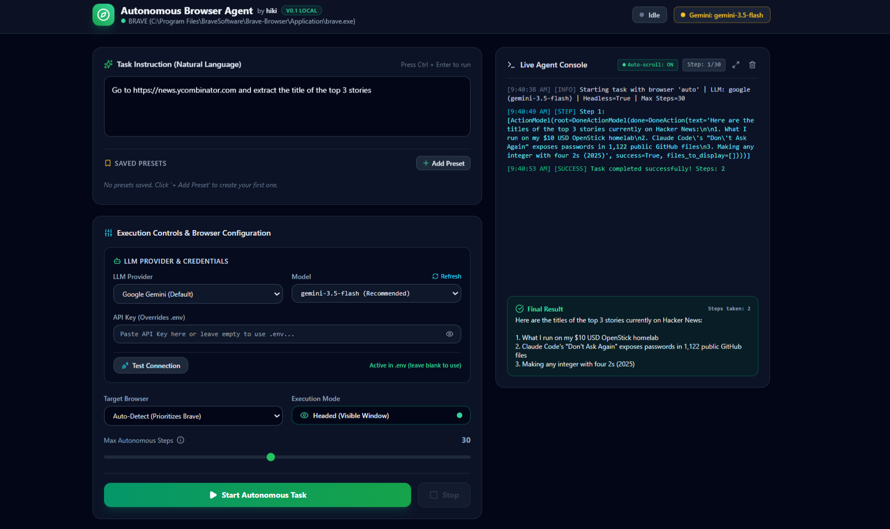

# Autonomous Browser Agent by hiki

A unified, local autonomous browser agent built on **browser-use**, **Playwright**, and **FastMCP**. It connects directly to your local **Brave**, **Google Chrome**, **Microsoft Edge**, or **Playwright Chromium** browser in non-headless (visible) mode, orchestrates multi-tab operations, supports human-in-the-loop tasks (solving CAPTCHAs, 2FA, OTPs), and exposes both a standalone CLI and an MCP Server.



---

## 🌟 Key Features

- **Modern Graphical User Interface (GUI)**: Single-page responsive dashboard (FastAPI + Tailwind CSS + SSE streaming) with clickable quick action presets, live console logs, and human-in-the-loop alert banners.
- **Desktop Launcher Shortcut (`start_ui.bat`)**: Double-click to instantly launch the server and open the GUI at `http://localhost:8000`.
- **Visible / Headed Execution (`headless=False` by default)**: Watch your agent navigate, fill forms, and switch tabs in real-time. Easily intervene to solve CAPTCHAs, biometric prompts, or 2FA/OTPs.
- **Local Browser Auto-Detection**: Automatically detects your installed Brave Browser (`C:\Program Files\BraveSoftware\Brave-Browser\Application\brave.exe`), Google Chrome, Edge, or Playwright's Chromium.
- **Multi-Tab Orchestration**: Built-in support for concurrent multi-tab workflows (e.g. Tab 1 generates a temporary email via `mail.tm`, Tab 2 fills a registration form, agent switches back to Tab 1 to read the OTP/verification link, then switches back to Tab 2 to submit).
- **Stealth & Anti-Detection**: Injects Chromium anti-automation bypass flags (`--disable-blink-features=AutomationControlled`, custom User-Agent, spoofed `navigator.webdriver=None`).
- **Unified FastMCP Server**: Control the autonomous browser agent through any standard MCP client (Claude Desktop, Cursor, Antigravity, etc.).
- **Standalone CLI Runner**: Execute arbitrary natural language tasks directly from your terminal with rich colorized feedback.
- **Self-Test Suite**: Verification script (`test_agent.py`) that tests headed execution, stealth, and multi-tab orchestration.

---

## 📁 Project Architecture

```
ai/
├── assets/
│   └── preview.png           # Dashboard UI preview screenshot
├── start_ui.bat              # One-click desktop launcher for the Web GUI
├── gui.py                    # FastAPI modern Web GUI with real-time SSE streaming
├── run_task.py               # Standalone CLI interface
├── test_agent.py             # Self-test script (Headed/Multi-tab/Stealth)
├── .env.example              # Environment variables template
├── LICENSE                   # Open-source MIT License
├── requirements.txt          # Python dependencies
├── pyproject.toml            # Modern project packaging specification
├── README.md                 # Project documentation and MCP setup guide
└── src/
    ├── __init__.py           # Package initialization
    ├── config.py             # Browser auto-detection and runtime settings
    ├── browser_manager.py    # Headed browser controller and stealth configuration
    ├── multi_tab_manager.py  # Multi-tab orchestration and OTP extraction
    ├── custom_controller.py  # browser-use Controller with multi-tab & HITL actions
    ├── agent.py              # LLM factory and autonomous loop coordinator
    └── mcp_server.py         # FastMCP Server exposing standard MCP tools
```

---

## 🖥️ Launching the Web GUI

### Option 1: Double-Click Desktop Launcher
Simply double-click **[`start_ui.bat`](file:///c:/Users/hiki/Downloads/ai/start_ui.bat)** in Windows Explorer. It activates `.venv`, starts the server, and automatically opens your default browser at `http://localhost:8000`.

### Option 2: Command Line
```powershell
.\.venv\Scripts\python.exe gui.py
```

### Dashboard Highlights:
- **Dynamic LLM Provider & Credentials**: Choose between **Google Gemini**, **OpenAI**, **Anthropic**, **Local AI (Ollama / LM Studio)**, or **Custom OpenAI-Compatible** endpoints (OpenRouter, DeepSeek, Groq, Together AI, etc.).
- **Dynamic Real-Time Header Badge**: Displays current provider & model (e.g. `Gemini: gemini-3.5-flash`, `OpenAI: gpt-5-mini`) with live health coloring: Green (Verified & Active), Amber (Unverified / Modified), and Red (Offline / Error).
- **Automatic Model Fetching & Dynamic Selector**: Auto-queries the provider's API (`POST /api/list-models`) to populate a dynamic model dropdown with recommended fast/flash models on top (e.g. `gemini-3.5-flash`, `gemini-3.8-flash`, `gpt-4o-mini`). Includes a **"🔄 Refresh"** button and an **"Other / Custom"** option for manual model strings.
- **Live Connection Test ("Test Connection")**: Interactive button next to credentials to send a lightweight probe to the target LLM API, displaying an immediate green success check or clear red error badge without launching a full browser task.
- **Custom OpenAI-Compatible Support**: Exposes Custom Base URL, API Key, and Model Name simultaneously for third-party inference providers.
- **Custom Preset Manager**: Dynamic task presets stored locally in browser `localStorage`. Click "+ Add Preset" to save custom recurring flows with title and prompt, click pills to auto-populate the task area, and delete unwanted presets with a single click `(x)`.
- **Interactive API Key Box**: Password-masked input with show/hide toggle. Enter an override key on the fly without editing `.env`.
- **Local AI Endpoint**: Selecting Local AI swaps the key input for a Base URL field (`http://localhost:11434/v1` or LM Studio `http://localhost:1234/v1`) with zero API keys required.
- **Max Autonomous Steps Guardrail Tooltip**: Interactive `(ℹ)` popover explaining upper action boundaries and stall prevention.
- **Full-Context Console Inspection (Maximize Mode)**: Click the `⛶` button in the Live Agent Console to expand it to full-screen overlay mode with auto-scroll toggle for inspecting verbose agent thoughts, multi-tab DOM states, and tool logs without clipping.
- **Human-in-the-Loop Alert Banner**: Blinking banner alerting you to solve CAPTCHAs/2FA in the open browser window, with an instant `I've Completed It` resume button.

---

## 🚀 Quickstart

### 1. Prerequisites & Virtual Environment
Ensure Python 3.11+ is installed. Activate the project virtual environment:

```powershell
# In PowerShell (Windows)
.\.venv\Scripts\Activate.ps1
```

If setting up fresh:
```powershell
python -m venv .venv
.\.venv\Scripts\python.exe -m pip install -r requirements.txt
.\.venv\Scripts\playwright.exe install chromium
```

### 2. Configure Environment Variables
Copy `.env.example` to `.env` and set your preferred LLM API key:

```ini
# Provide at least one API key:
GOOGLE_API_KEY=your_gemini_api_key_here
# or
OPENAI_API_KEY=your_openai_api_key_here

# Browser Preference (auto, brave, chrome, edge, chromium)
BROWSER_TYPE=auto

# Visible / Headed mode (default: false for visible window)
BROWSER_HEADLESS=false
```

---

## 🧪 Testing & Verification

Run the self-test script to verify local browser detection, non-headless execution, anti-bot stealth, and multi-tab orchestration:

```powershell
# Headed mode (visible Brave / Chrome window)
.\.venv\Scripts\python.exe test_agent.py

# Headless mode
.\.venv\Scripts\python.exe test_agent.py --headless

# Force specific browser (e.g. Playwright Chromium)
.\.venv\Scripts\python.exe test_agent.py --browser chromium
```

### Verification Checks Performed:
1. **Browser Detection**: Detects installed browser binaries and resolves the best match.
2. **Stealth Verification**: Confirms `navigator.webdriver` is suppressed (`None` / `False`).
3. **Tab 1 Navigation**: Loads `https://mail.tm`, verifies interactive element access, and reads the generated temp email.
4. **Tab 2 Launch**: Opens a second tab (`https://example.com`) simultaneously in the same browser session.
5. **Cross-Tab Switching**: Validates bi-directional switching between Tab 0 and Tab 1 without losing state.

---

## 💻 Standalone CLI Usage (`run_task.py`)

Run autonomous browser tasks with a plain-text prompt:

```powershell
# Check detected browsers and current status
.\.venv\Scripts\python.exe run_task.py --status

# Execute a multi-tab autonomous workflow
.\.venv\Scripts\python.exe run_task.py "Go to mail.tm, copy the temporary email address, open a second tab to example.com, and summarize the page content"

# Force Brave browser with max 20 steps
.\.venv\Scripts\python.exe run_task.py "Search Google for latest Playwright releases" --browser brave --max-steps 20

# Run in headless mode (if GUI is not required)
.\.venv\Scripts\python.exe run_task.py "Check GitHub status" --headless
```

### CLI Arguments:
| Argument | Description | Default |
|---|---|---|
| `task` | Natural language instruction for the agent | Positional |
| `--browser` | Target browser (`auto`, `brave`, `chrome`, `edge`, `chromium`) | `auto` |
| `--headless` | Run in headless mode | `False` (runs visibly) |
| `--max-steps` | Maximum autonomous action steps | `30` |
| `--model` | LLM model name (e.g. `gemini-2.0-flash`, `gpt-4o-mini`) | `.env` setting |
| `--provider` | LLM provider (`google`, `openai`, `anthropic`) | `google` |
| `--cdp-url` | Attach to an already running browser instance | `None` |
| `--status` | Display detected browser table and exit | - |

---

## 🔌 FastMCP Server Integration

The agent exposes standard MCP tools for integration into MCP client ecosystems (Claude Desktop, Cursor, Antigravity, etc.).

### Launching the MCP Server Directly:
```powershell
.\.venv\Scripts\python.exe src\mcp_server.py
```

### Exposed MCP Tools:

1. **`run_browser_task`**:
   - `prompt` (string): Natural language prompt.
   - `browser_type` (string): `auto`, `brave`, `chrome`, `edge`, `chromium`.
   - `headless` (boolean): Default `false` for visible human-in-the-loop operation.
   - `max_steps` (integer): Maximum action limit.

2. **`get_browser_status`**:
   - Returns JSON containing detected browser binaries, resolved executable, and active configuration.

3. **`multi_tab_quick_flow`**:
   - Coordinates opening `tab1_url` and `tab2_url`, auto-extracting temp email/tokens, and validating switching.

### MCP Client Configuration

#### Claude Desktop (`%APPDATA%\Claude\claude_desktop_config.json`):
```json
{
  "mcpServers": {
    "local-browser-agent": {
      "command": "c:\\Users\\hiki\\Downloads\\ai\\.venv\\Scripts\\python.exe",
      "args": [
        "c:\\Users\\hiki\\Downloads\\ai\\src\\mcp_server.py"
      ],
      "env": {
        "GOOGLE_API_KEY": "your_api_key_here",
        "BROWSER_HEADLESS": "false"
      }
    }
  }
}
```

---

## 🛡️ Human-in-the-Loop & Multi-Tab Details

- **Visible Interaction**: When CAPTCHAs (Cloudflare, reCAPTCHA, Turnstile) or 2FA codes are encountered, the agent triggers the `request_human_help` controller action. The terminal displays a highlighted alert and pauses execution so you can solve it directly in the open browser window.
- **Multi-Tab Actions**: The custom controller registers `open_new_tab`, `list_open_tabs`, and `switch_tab_by_keyword`, giving the LLM native awareness of multiple concurrent tabs.

---

## 🙏 Credits & Acknowledgements

This project is built on the shoulders of incredible open-source tools and libraries:

- **[browser-use](https://github.com/browser-use/browser-use)** — An exceptional browser automation library designed specifically for AI agents, created by Gregor Zetsche and the browser-use team. It powers the core perception, vision DOM extraction, and autonomous agent loops.
- **[Playwright](https://github.com/microsoft/playwright)** — Microsoft's robust, lightning-fast cross-browser automation framework that controls the local browser instance (Brave, Chrome, Edge, Chromium) in non-headless mode.
- **[FastMCP](https://github.com/jlowin/fastmcp)** — The high-performance Python framework for building Model Context Protocol servers.
- **[FastAPI](https://fastapi.tiangolo.com/)** & **[Tailwind CSS](https://tailwindcss.com/)** — Driving the lightweight, responsive local web dashboard.

---

## 📄 License

Distributed under the [MIT License](LICENSE). Built with ❤️ by [hiki](https://github.com/hiki02283).
